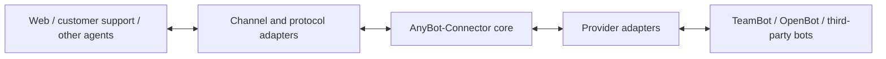

# AnyBot-Connector

An open interoperability layer for connecting personal and enterprise bots to applications and collaboration workflows.

**Status: design / RFC.** This initial repository contains the specification proposal, implementation work packages and acceptance criteria. It does not yet contain a runnable connector, an npm package, or a verified TeamBot integration. CXF review and ZCode / Kimi implementation are pending.

中文定位：让不同 BOT 提供方与业务场景通过明确的能力、身份和任务契约互联。TeamBot 是首个计划接入的企业提供方；OpenBot 和独立第三方实现用于后续验证可移植性。

## Design principles

- Reuse HTTP, MCP, A2A and AG-UI where their semantics fit. Protocol support is individually implemented and tested, never inferred from this diagram.
- Keep bot execution, durable task state and domain authorization with the provider that owns them.
- Separate channel adapters from provider adapters so integrations can be composed.
- Declare capabilities and reject unsupported behavior explicitly.
- Preserve caller isolation, idempotency, cancellation outcomes and authority revocation across interfaces.
- Keep the public project usable without private repositories, enterprise accounts or production credentials.

## Start with the design

| Document | Purpose |
| --- | --- |
| [详细方案](docs/PLAN.zh-CN.md) | Product scope, architecture, phases, TeamBot integration and decisions |
| [RFC 0001](spec/0001-connector-contract.md) | Proposed provider, channel, capability, task and error contracts |
| [实施拆分](docs/IMPLEMENTATION.zh-CN.md) | Dependencies, file ownership and CXF / ZCode / Kimi work packages |
| [验收矩阵](docs/ACCEPTANCE.zh-CN.md) | Contract, reliability, isolation and real-platform evidence |
| [支持矩阵](docs/SUPPORT-MATRIX.md) | Planned versus verified capabilities |
| [项目状态](STATUS.md) | What has happened and what remains pending |
| [来源与复用](docs/PROVENANCE.md) | Standards and code provenance policy |

The first implementation milestone targets a text-only HTTP path, a provider contract, a deterministic reference provider, a TeamBot adapter and equivalent MCP operations. A Knocket-compatible chat-completions subset is a separate milestone with its own live-platform gate. A2A, AG-UI, attachments and programmatic human handoff are later extensions.

There is no install command yet. A runnable quickstart will be added only after implementation and verification.

## Contributing and license

Read [CONTRIBUTING.md](CONTRIBUTING.md) before implementing a work package. Original contributions are licensed under [MIT](LICENSE). Third-party code retains its own applicable license and notices. The project name does not assert trademark or package-name availability.
