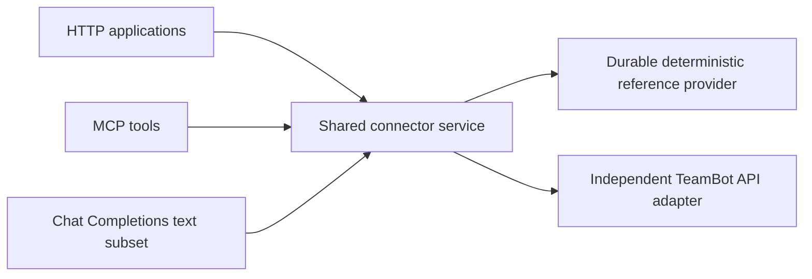

# AnyBot-Connector

A small, open interoperability layer that connects bot providers to HTTP, MCP and
application channels through one explicit task and authority contract.

**Status: runnable reference alpha; isolated TeamBot backend verified.**
The deterministic reference provider runs without a model account or private
repository. The TeamBot adapter and chat channel also passed isolated backend checks; **real enterprise and Knocket acceptance is pending**.
No npm publication or production deployment has occurred.



## Run the reference provider

Requires Node.js 22.16+ and npm. No compilation or private dependency is needed.

```sh
git clone https://github.com/Harzva/anybot-connector.git
cd anybot-connector
npm ci --ignore-scripts
export ANYBOT_TOKEN="$(node -e "process.stdout.write(require('node:crypto').randomBytes(24).toString('hex'))")"
node src/cli/index.mjs init connector.local.json ./state
node src/cli/index.mjs check connector.local.json
node src/cli/index.mjs serve connector.local.json
```

In a second terminal with the same token:

```sh
curl -s http://127.0.0.1:8790/v1/connections/demo/tasks \
  -H "Authorization: Bearer $ANYBOT_TOKEN" -H 'Content-Type: application/json' \
  -d '{"requestKey":"hello-1","input":{"type":"text","text":"Hello"}}'
```

The response contains an opaque `handle`. Query `/v1/tasks/<handle>` with the same
bearer credential. The completed text is `[reference] Hello`: this is a fixture,
not an LLM response. Submit the same key and payload again to recover the same
task; changing the text with that key returns `IDEMPOTENCY_CONFLICT`.

Stop with `node src/cli/index.mjs stop connector.local.json` or Ctrl+C. Keep the
state directory to recover tasks after restart. It contains private reference
input/output and must not be committed. Edit the config's identity operations or
remove an identity to revoke access; policy is rechecked during operations and
before result disclosure. [Host and recovery details](docs/HOST-INTEGRATION.md).

## MCP and channel examples

Start the same service with `serve connector.local.json --stdio demo` to expose
MCP tools over stdio alongside HTTP. The launching host fixes the MCP principal;
tool arguments cannot choose an identity. MCP clients should launch the CLI
process and preserve stdout for the protocol. Logs go to stderr.

These self-contained synthetic examples demonstrate the exported bindings:

```sh
node examples/http-server.mjs
node examples/mcp-server.mjs
node examples/knocket-channel.mjs
```

They use a small in-memory demo service, not the durable provider. The channel
accepts only fixed model aliases, bounded user/assistant text messages and optional
`stream:false`. It rejects system/developer roles, tools, attachments, unknown
options and streaming. Missing retry keys produce independent request contexts;
a shared application credential does not identify a visitor. See the exact
[HTTP, MCP and channel bindings](spec/0003-bindings.md).

## Guarantees and limits

- One process per state directory. Atomic/fsynced correlation journal; provider
  owns task outcomes. No distributed writer or task scheduler.
- Same-key concurrency, caller/end-user isolation, crash recovery and cancellation
  races have focused tests. An uncertain submission is queried, never silently
  replayed as another POST. TeamBot requires its opaque receipt: a response lost
  before receipt persistence may need operator reconciliation. No unlimited exactly-once claim.
- Core journals routing metadata, private provider receipts and input digests. Reference provider stores
  its own task facts. State is capped at 10000 tasks and 8 MiB per store; admission
  fails when capacity is reached. No automatic retention cleanup.
- TeamBot requires explicit operator trust and a fixed endpoint. Publication
  consistency checks do not prove enterprise ownership. Credentials remain with
  the host. No private TeamBot code is vendored.
- A2A, AG-UI, attachments, input continuation, token streams and programmatic
  human handoff are not implemented. No real-platform or production claim.

## Verify and contribute

```sh
npm test
npm run check
```

Tests use synthetic data and ephemeral loopback ports. The package check audits
public dependency sources/licenses and shipped contents; it is not a security
certification. [Verification report](docs/VERIFICATION.md) records exact results
and limitations. Source is [MIT licensed](LICENSE); dependencies retain their
own licenses. The package remains `private: true` until a separate npm decision.

| Document | Purpose |
| --- | --- |
| [详细方案](docs/PLAN.zh-CN.md) | Scope, architecture and phases |
| [Contract](spec/0001-connector-contract.md) / [API](spec/0002-alpha-api.md) | Public implementation boundary |
| [CXF 决策](docs/ARCHITECTURE-REVIEW.zh-CN.md) | Actual consultation and coordinator decisions |
| [实施与所有权](docs/IMPLEMENTATION.zh-CN.md) | Contributions and integration responsibilities |
| [验收要求](docs/ACCEPTANCE.zh-CN.md) / [支持矩阵](docs/SUPPORT-MATRIX.md) | Evidence levels and live gates |
| [来源](docs/PROVENANCE.md) / [依赖](docs/DEPENDENCIES.md) | Reuse and licenses |
| [状态](STATUS.md) / [Contributing](CONTRIBUTING.md) | Current delivery and changes |
