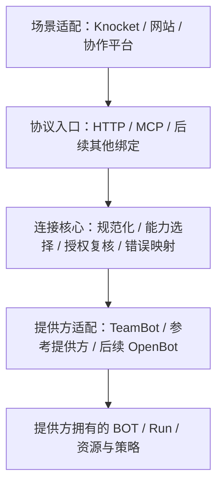

# AnyBot-Connector 详细方案

日期：2026-10-26。状态：已完成首轮 CXF 实际咨询，决策见 ARCHITECTURE-REVIEW.zh-CN.md。本文描述目标和工作拆分，不代表所有能力已经实现。

## 1. 产品定位与首版目标

AnyBot-Connector 是开源 BOT 互联组件：让一个 BOT 提供方接入多个场景，也让一个场景可以更换 BOT 提供方。可交付内容是互操作约定、适配器 SDK、参考实现、场景连接器与一致性测试。

首版用可验证的文字任务闭环回答三个问题：

1. TeamBot 的已发布 BOT 能否通过同一契约被 HTTP 应用和 MCP 客户端调用？
2. 请求重试、会话隔离、查询与取消能否保持同一份上游事实？
3. 不依赖 TeamBot 私有源码的参考提供方能否接入相同场景？

第一版不承担新的 Agent 执行器、企业身份系统、知识库、应用市场、通用工作流引擎或全功能聊天界面。BOT 的内部工具、模型和知识继续由提供方管理。后续确有跨产品重复需求时，再从已验证场景提炼通用能力。

## 2. 与现有协议和产品的关系

| 对象 | 现有职责 / 本项目的使用方式 |
| --- | --- |
| HTTP API | 面向业务系统的显式请求、状态与结果接口；具体端点由绑定文档定义 |
| MCP | 复用官方协议与 SDK 暴露有限 BOT 操作；也可由 BOT 自身消费工具和资源 |
| A2A | 独立 Agent 之间的发现、任务和协作；后续基于真实需求适配 |
| AG-UI | Agent 与应用之间的事件和交互；适用范围包含聊天渠道，不能把它误解成纯 UI 组件库 |
| AnyBot-Connector | 在提供方、协议和场景之间落实能力声明、身份映射、结果与错误转换及一致性测试 |
| TeamBot | 企业 BOT 提供方，负责真实企业主体、权限、执行、知识与审批 |
| OpenBot | 后续个人 BOT 提供方；与企业身份和资料分别适配 |

本项目先形成可运行的互操作配置与实现。仅当实际场景证明现有协议存在共同缺口时，才提出扩展；不把项目名称直接称为行业标准。

## 3. 四层架构与依赖方向

### 3.1 Core

- 定义与验证运行时无关的输入、输出、能力声明和错误格式。
- 用可信配置选择 connection、provider、publication 和调用授权；请求不能传任意上游地址或模块路径。
- 接受宿主提供的身份验证、授权复核、凭据解析和审计接口。
- 规范化幂等语义、超时与结果未知；不创建第二份 BOT 执行状态权威数据库。
- 不直接依赖 TeamBot 身份接口、数据库、桌面 IPC、具体 LLM 或第三方渠道 SDK。

### 3.2 Provider adapter

最小操作为 `describe`、`submit`、`get`；`cancel` 和 `observe` 按能力声明提供。适配器负责提供方 API 版本、固定路由、状态/错误转换、结果结构验证以及权限复核接点。

### 3.3 Transport adapter

HTTP 与 MCP 对相同操作使用相同核心服务。MCP 使用官方 SDK；工具列表可按权限过滤，但每次执行仍强校验。协议入口不直接调用 LLM、不绕过 provider，也不把用户传入的角色字符串升级为系统指令。

### 3.4 Channel adapter

负责渠道事件验证、稳定客户/会话映射和回复格式。渠道自身是否支持重试键、附件、流式输出、人工接管，应分别声明。渠道不知道客户稳定身份时，使用独立请求上下文；不能用提示词、首句内容或共用 API Key 推测客户身份。

## 4. 身份、状态和数据归属

| 信息 | 权威来源 | Connector 可以保存的内容 |
| --- | --- | --- |
| 企业主体、成员及资源权限 | 提供方的企业服务 | 最小必要的经验证标识与短期授权上下文 |
| 客户 / 调用应用身份 | 渠道认证或可信宿主 | 有命名空间的主体引用，不接受正文自报身份 |
| BOT 与发布授权 | BOT 提供方 | 固定连接映射、能力快照、协议版本 |
| 任务状态、结果、取消事实 | 执行该任务的提供方 | 有来源的句柄、路由记录、有限缓存 |
| 连接器运行状态 | Connector | 限流、连接生命周期、健康信息与脱敏审计 |
| 人工接管状态 | 具有接管能力的平台 | 平台确认回执与版本；无确认时保持待处理或未知 |

区分调用应用、外部最终用户、企业员工和执行 BOT，不能用单一 `userId` 混合表达。外部客户不会因为能向客服 BOT 提问就成为企业成员。

TeamBot adapter 的接入条件是服务器可验证的授权与发布归属。仅比较客户端填写的企业 ID、BOT 名称或两个分别成功的健康检查，不足以证明发布属于目标企业。缺少机器可验证的归属证据时，保留人工受信配置的限制，不宣称自动发现与验证已经成立。

## 5. 请求、重试和取消

正常链路：渠道认证 → 固定连接选择 → 能力验证 → 当前授权 → 提交上游 → 获取真实句柄 → 查询/观察 → 再次授权 → 返回结果。

幂等范围至少包括 connection、已验证调用主体、publication / grant 版本和逻辑 request key。同键同载荷跨 HTTP/MCP 应定位同一任务；同键不同载荷返回冲突。幂等保证必须跨重启成立；若提供方无法支持 durable idempotency，需显式降低能力并拒绝宣称 exactly-once。客户端未给 key 时可以为本次调用生成 key，但两次独立请求不能自动被当成同一次操作。

提交中断、连接丢失或上游超时可能意味着任务已经被接受。此时返回 `UPSTREAM_OUTCOME_UNKNOWN` 及可用恢复线索，禁止自动换 key 重提。超时属于本次等待的观察结果，不自动成为上游任务的 failed 状态。

取消请求已受理不等于任务已取消。以提供方最后确认的状态为准；撤权后禁止新的受管操作和结果披露，已发生的外部副作用不能被虚构为已撤销。

## 6. 首版范围

### M0：公开设计与准备

交付本方案、RFC、工作包、支持矩阵、验收矩阵、MIT 许可和来源规则。完成 CXF 实际审阅并记录采纳、校正、暂缓项后，冻结实现所需的最小合同。

### M1：可运行参考闭环

- 原生 Node.js / ESM 为初始实现候选，具体最低版本在初始化工程时锁定。
- 单进程、单部署者控制的配置；无自动公网暴露。
- Core 与一个明确标注为确定性夹具的 reference provider。
- HTTP 提交、查询、取消；CLI 初始化、检查、启动与停止。
- 持久化范围只覆盖必要的路由和重试元数据；BOT 状态由 provider 持有。
- 干净环境仅使用公开仓库即可运行的 quickstart。

### M2：TeamBot 与 MCP

- TeamBot adapter 通过已发布服务调用，不导入企业私有模块。
- HTTP / MCP 四类操作的一致性和权限隔离测试。
- 通过真实企业服务和隔离资料验证准入、撤权、会话隔离；付费模型或真实企业账号验收另记。
- TeamBot 进程内接入、市场 UI 或安装器需要单独的产品文件归属交接。

### M3：Knocket 场景试点

- 先实现 Chat Completions 的明确文字子集，模型别名映射固定 BOT。
- 不支持的参数、工具或内容类型明确报错。
- 区分真实逐 token 流与完成后的单次 SSE 输出；不捏造 token 用量。
- 用真实账号确认请求字段、超时、重试、双访客隔离与人工接管。
- 接管能力只能依据平台真实 API / 事件开放情况实现。

### M4：可移植性与扩展

加入独立提供方与第二个真实场景，再逐项推进 OpenBot、A2A、AG-UI、附件或审批。两个同源 adapter 通过测试不足以证明独立实现互操作；至少一次由公开合同独立实现的接入是通用性门槛。

## 7. TeamBot 接入工作量的判断

初版主要工作是已有发布能力的映射，工程难度预计中低；企业生产可用性的主要工作在身份归属、撤权、失败恢复和真实平台验收，难度更高。这是范围判断，不是工期承诺。

复用方向为已公开 / 可授权使用的接口和已验证语义。现有私有实现仅作为受控核对依据，不能直接拷贝到开源仓库。若后续希望开源既有代码，应另列文件、来源、许可和允许公开的内容，再决定是否移植。

## 8. 开源边界与发布

公开：原创规范、SDK、通用 adapter、合成 fixtures、测试、示例、许可证和兼容性说明。保持私有：企业业务代码、原始代理会话、企业/员工信息、配置、凭据和私有 Git 历史。

GitHub 公共仓库建立与运行库发布是两个阶段。第一阶段允许以明确标注的设计仓库公开。npm 发布与生产部署需要独立的打包、验证和发布动作，不从建仓行为推导已完成。

## 9. 需要 CXF 裁决的具体问题

1. 当前范围与 MCP、A2A、AG-UI 的重合是否可通过更薄的适配解决？哪些确属本项目增量？
2. 最小 contract 的三个必选操作与可选 cancel / observe 是否足够？
3. 如何在不复制任务权威状态的前提下完成跨入口幂等和崩溃恢复？
4. 外部客户调用 TeamBot 时，调用凭据与员工授权应如何组合，哪些证据缺失必须阻断？
5. 第一版应包含哪些持久化、取消和错误语义，哪些可以明确延期？
6. ZCode / Kimi 的模块划分是否会导致共享文件竞争或测试只验证自身实现？

实际回复到达前，这些问题保持待审；不能把本计划写成 CXF 已批准。

官方参考与来源范围见 [PROVENANCE.md](PROVENANCE.md)。
